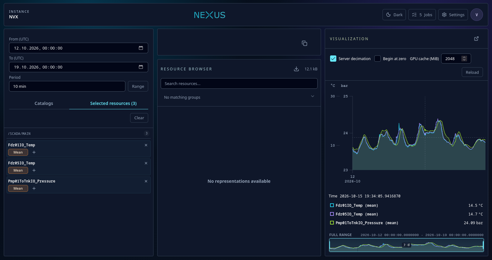
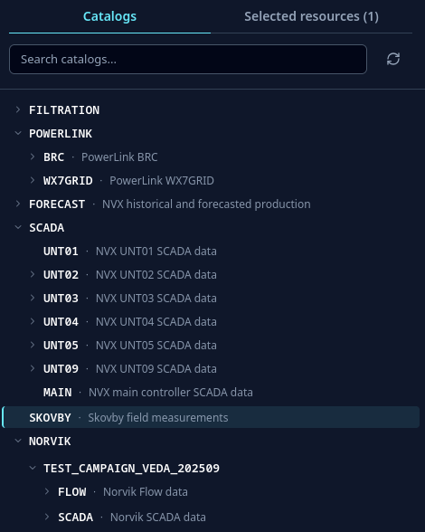
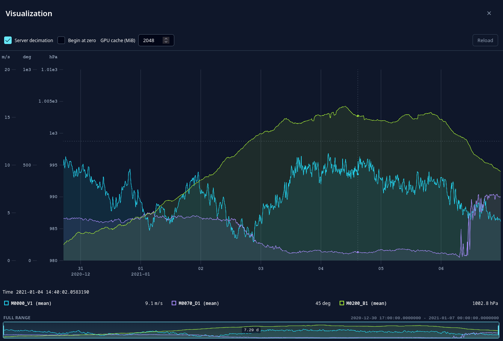
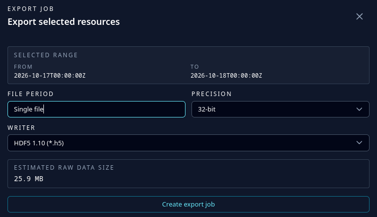

# Nexus

[](https://github.com/nexus-main/nexus/releases)

Nexus provides visibility into time-series data and gives users unified ways to access, visualize, export, and reuse it.

Experienced users often know how to work with the available data directly. For new users, students, or new scientists, the same data can be much harder to approach: raw files may be poorly documented, spread across historically grown storage systems, and stored in vendor-specific formats that require proprietary tooling. Nexus addresses this with plugins that can read data from different structures and systems, so users do not need to learn every underlying format before they can work with the data. Without a shared access layer, each new user often has to repeat the same work just to understand what data exists and how to read it.

Nexus provides unified interfaces for that data: a web UI, a REST API, and generated clients for common programming environments. Users can browse measurement campaigns, inspect available signals, visualize data, export it, or load it directly into their own scripts and applications. The data itself can stay where it already is.

Useful links:

- [Nexus documentation](https://nexus-main.github.io/nexus/docs/)
- [GitHub Pages UI test instance](https://nexus-main.github.io/nexus/) — static frontend deployment; API-backed features require a running Nexus server.

<p align="center">
  
</p>

## What Nexus helps with

Nexus is useful when measurement data exists, but finding and using it still takes too much manual work. It helps answer everyday questions such as:

- What data is available for a measurement campaign, test run, or project?
- Which signals, sample periods, and time ranges exist?
- Can I inspect the data before writing an analysis script?
- Can I access the same data from the browser, Python, C#, TypeScript, or Matlab?
- Can I work with vendor-specific files without installing every vendor tool locally?
- Can users get access without copying large raw data files around?
- Can I export a selected time range in a format another tool understands?

The goal is to make data access predictable. Nexus gives users a common way to discover, inspect, visualize, export, and stream data, while the original files and systems can stay where they are.

## What Nexus provides

### A shared view of time-series data

Nexus organizes data into catalogs, resources, and representations. In practice, a catalog is often a measurement campaign, a resource is a signal or channel, and a representation describes how that signal can be read, for example at a certain sample period.

Users can browse this structure in the web interface instead of searching through folders or asking which file contains which signal.

<p align="center">
  
</p>

### Fast inspection and visualization

Selected signals can be plotted directly in the browser. Nexus is designed for large time-series data and supports progressive loading, GPU-based rendering, efficient streaming, and hardware-accelerated server-side decimation for heavy visualization requests.

These viewing features are meant for data sets that are too large to handle comfortably with a naive plot. One example is electrical measurement data recorded with microsecond sample periods. During interactive viewing, Nexus can decimate data on the server and render efficiently in the browser, making it possible to inspect tens of gigabytes of time-series data without first downloading the full data set. Full export or download still transfers the selected data in full.

This makes it possible to inspect data before deciding whether it should be exported or processed further.

<p align="center">
  
</p>

### Export for everyday tools

Nexus can export selected data into common formats such as CSV, HDF5, Matlab v7.3, and Famos. Exports can include the related license information where available.

Custom data writers can be added when a project needs another output format.

<p align="center">
  
</p>

### Direct access from code

For analysis and automation, data can be streamed directly into client applications. Nexus provides generated clients for:

- Python: [`nexus-api`](https://pypi.org/project/nexus-api/) on PyPI
- C# / .NET: [`Nexus.Api`](https://www.nuget.org/packages/Nexus.Api) on NuGet
- TypeScript: [`@apollo3zehn/nexus-api`](https://www.npmjs.com/package/@apollo3zehn/nexus-api) on npm
- Matlab (limited)

See [API clients](clients/index.md) for installation links, package names, and usage notes.

### Extensible data sources

Nexus does not require all data to be converted into one central file format. Instead, plugins teach Nexus how to read from existing systems and expose them through the same UI, API, and generated clients.

These plugins can provide access to different kinds of sources, including:

- files in open or vendor-specific formats,
- databases,
- remote services and APIs,
- other Nexus instances,
- project- or organization-specific storage structures.

Additional plugins can be developed for new source types without changing how users browse and access the data through Nexus. See [Extensibility](extensibility/index.md) for plugin documentation.

### Controlled access

Nexus supports user access, personal access tokens, and catalog-level permissions. Tokens can be limited to the catalogs they need, which makes them suitable for scripts and automated workflows.

For interactive users, Nexus is usually placed behind a trusted authentication proxy. The proxy forwards identity, groups, and catalog permissions through configured `X-Forwarded-*` headers. See the [deployment notes](configuration/deployment-notes.md) for the supported authentication and authorization headers.

## Main features

- Web interface for browsing, searching, selecting, and inspecting time-series resources
- GPU-based browser visualization for large time-series data
- Hardware-accelerated server-side visualization decimation for slow or very large requests
- Interactive viewing of very large measurements, including high-frequency electrical data, without downloading the full data set first
- Export to common data formats
- REST API for automation and integration
- Generated clients for Python, C#, TypeScript, and Matlab (limited)
- Extensible data source and data writer model
- Personal access tokens for scripts and applications
- Catalog aliases and range handling
- Git-backed configuration history
- Angular-based UI served by the Nexus server

## Where to start

- Use [API clients](clients/index.md) when you want to load or export data from Python, C#, TypeScript, or Matlab.
- Use [Extensibility](extensibility/index.md) when Nexus needs to read a new storage system, file format, database, or service.
- Use [Data source configuration](configuration/data-sources.md) when you need to connect installed plugins to concrete catalog paths.
- Use [Configuration options](configuration/options.md) when you need to configure the server with `settings.json` or environment variables.
- Use [Git-backed configuration history](configuration/git-history.md) when you want to track and review administrative configuration changes.

## Basic concepts

### Catalog

A catalog groups related data. This is often a measurement campaign, test run, simulation run, or project data set.

Example:

```text
/SAMPLE/LOCAL
```

### Resource

A resource is a named signal or channel inside a catalog. It can have metadata such as unit, description, location, sensor information, or project-specific properties.

Example:

```text
/SAMPLE/LOCAL/T1
```

### Representation

A representation describes how a resource can be read. For time-series data, this usually includes the sample period.

Example:

```text
/SAMPLE/LOCAL/T1/1_s
```

### Aggregation

Nexus can aggregate data on demand. For example, a signal stored at `1 s` can be requested as a `10 min` mean value:

```text
/SAMPLE/LOCAL/T1/10_min_mean
```

Aggregated results can be cached so repeated requests are faster.

## API and integration docs

The live Nexus API explorer is available from a running server at `/api`.

This documentation focuses on the technical parts that are useful when integrating or extending Nexus:

- [API clients](clients/index.md)
- [Extensibility](extensibility/index.md)
- [Configuration](configuration/index.md)
- <xref:Nexus.Api>

## Build and run locally

Required tools:

- .NET SDK 9
- Node.js 24 with npm, for UI development

Start the Nexus server from a local checkout:

```bash
git clone https://github.com/nexus-main/nexus
cd nexus
dotnet run --project src/Nexus/Nexus.csproj
```

Then open:

```text
http://localhost:5000
```

For UI development, install the Angular dependencies with `npm ci` and start the development server:

```bash
cd src/Nexus.UI
npm ci
npm start
```

Then open:

```text
http://localhost:4200
```

The Angular development server proxies `/api` to the Nexus backend at `http://localhost:5000`.

Common development checks are:

```bash
dotnet test -c Release /p:BuildProjectReferences=false
```

```bash
cd src/Nexus.UI
npm run eslint
npm run lint
```

---

Supported by code contributions from Fraunhofer IWES.
